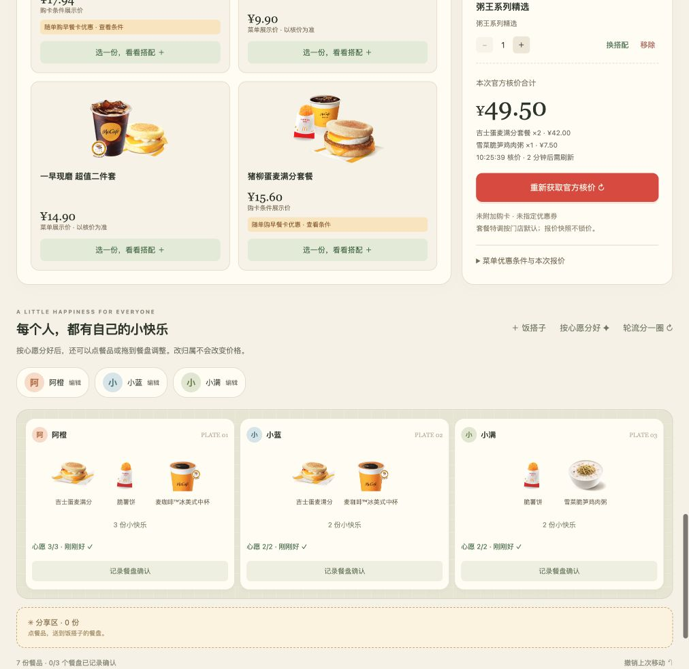
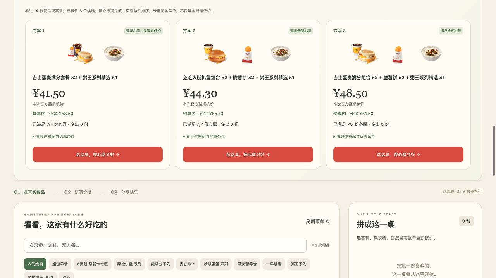

<p align="center">
  
</p>

<p align="center">
  <a href="LICENSE"></a>
  <a href="package.json"></a>
  <a href="MCP_INTEGRATION.md"></a>
  <a href="#立即在本地使用"></a>
</p>

<p align="center"><strong>真实菜单 · 官方核价 · 按人分餐</strong></p>

一起吃麦当劳，有人想喝咖啡，有人想吃汉堡，还有人只想分一份薯条。套餐拼图收集每个人的心愿，从门店当前菜单中组合套餐和单品，调用麦当劳 MCP 核清价格，再把餐品分到各人的餐盘。

适合 **1–6 位朋友、同事或家人**一起商量到店自取餐单：一人操作，大家一起选。

[本地运行](#立即在本地使用) · [真实案例](#一桌早餐怎么拼) · [MCP 接入](MCP_INTEGRATION.md) · [参赛记录](SUBMISSION.md)



## 从心愿到餐桌

1. **选餐厅，填心愿。** 选择附近门店，为每个人填写想吃的品类与份数，也可以设置整桌预算。
2. **看看可以怎么拼。** 比较最多 3 个已核价方案：多少钱、满足几份心愿、还缺什么、多出什么，连同优惠条件一起看清楚。
3. **换成喜欢的搭配。** 选中方案后，可以换饮品、换小食，再获取官方核价。未变餐品保留原来的分配。
4. **分好，带走餐单。** 按心愿分到各人餐盘，多余餐品留在分享区；支持手动调整，最后复制或下载带门店、选配、归属和核价时间的清单。

## 一桌早餐怎么拼

三位搭子，七份心愿：

| 搭子 | 想吃什么 |
| --- | --- |
| 阿橙 | 早餐堡/卷 ×1、薯饼 ×1、咖啡 ×1 |
| 小蓝 | 早餐堡/卷 ×1、咖啡 ×1 |
| 小满 | 粥 ×1、薯饼 ×1 |

套餐拼图生成了三桌方案，并逐桌向官方核价：



其中一桌是 **吉士蛋麦满分套餐 ×2 + 粥王系列精选 ×1**，当次核价 **¥41.50**，满足 **7/7 份心愿**，额外 **0 份**。选中后，三人的餐盘分别分到 3、2、2 份。

随后把两份套餐的饮品换成冰美式，重新核价为 **¥49.50**，再按心愿分好，就是上方餐桌截图中的结果。

以上为 **2026-10-13 上海黄浦华旭国际大厦餐厅**的真实验收记录。餐品与价格随门店、供应时段和权益变化；完整过程见[验收记录](docs/VERIFICATION.md)。

## 立即在本地使用

准备 **Node.js 22+**。项目无第三方运行依赖，无需 `npm install`。

```sh
git clone https://github.com/jumpersun/meal-puzzle.git
cd meal-puzzle
cp .env.example .env
```

按[官方 MCP 接入指引](https://github.com/M-China/mcd-mcp-server)申请 Token，在本机 `.env` 的 `MCD_MCP_TOKEN=` 后填入并保存，然后启动：

```sh
npm start
```

打开 **[http://127.0.0.1:4317](http://127.0.0.1:4317)**，选择餐厅，点击“填入示例心愿”，再点“帮我们拼一桌”。示例会根据当前早餐或非早餐菜单切换。

Token 仅由服务端读取，`.env` 已被 Git 忽略。默认位置为可修改的“上海人民广场”；端口占用时可用 `PORT=4318 npm start`。

**无 Token 体验：** 保留 `.env` 中的空值，启动后打开[趣味演示](http://127.0.0.1:4317/demo.html)，体验拼餐、分餐和清单交互。演示使用虚构菜单与示例价格，真实菜单和官方核价需配置 Token。

## 怎么把这桌拼出来

前端收集结构化心愿，服务端通过四个麦当劳 MCP 工具获取真实数据：

| 环节 | MCP Tool | 用途 |
| --- | --- | --- |
| 找餐厅 | `query-nearby-stores` | 查询附近门店 |
| 看菜单 | `query-meals` | 获取当前餐品、商品图、展示价与优惠标记 |
| 选搭配 | `query-meal-detail` | 读取套餐选项、默认搭配与数量规则 |
| 核价格 | `calculate-price` | 获取整桌实际报价 |

规划器最多读取 20 款相关产品的详情，组合候选并核价，再按**心愿满足度、实际总价、额外份数**排序，展示最多 3 桌。组合与分配由 JavaScript 完成，无需额外大模型或提示词。

菜单中的购卡条件价、促销标记与本次核价分别展示，方便判断优惠是否适用于这一桌。商品图片按官方编码对应，缺图时显示“暂无图片”。调用流程、参数校验与部署要求见 [MCP_INTEGRATION.md](MCP_INTEGRATION.md)。

## 使用说明

- **心愿范围**：支持鸡肉堡/卷、牛肉堡、薯条、麦乐鸡、可乐、咖啡、早餐堡/卷、薯饼、粥，共 9 类；每人每类最多 3 份，整桌最多 18 份。具体品名、冷热与杯型可在方案详情确认。
- **预算与选方案**：预算用于显示余量或超出金额，缺少和多出的餐品会明确列出。推荐来自有限候选范围，不保证全菜单最低价。
- **价格有效期**：改餐、换门店或刷新菜单后需重新核价。报价快照展示 2 分钟，到期隐藏金额并提示刷新；该时长为应用展示规则。
- **使用方式**：由一人在本机操作和记录餐盘确认，刷新页面会清空当前餐桌。支持到店自取餐单整理，采用门店默认特调；下单与支付需在官方渠道完成。

## 开发与验证

原生 JavaScript 前端 + Node.js 服务端，另提供 Worker 适配层。

| 代码 | 职责 |
| --- | --- |
| [`public/wish-planner.js`](public/wish-planner.js) | 心愿匹配、候选生成、按人分餐 |
| [`public/wishes.js`](public/wishes.js) / [`public/live.js`](public/live.js) | 心愿与方案界面、菜单、换搭配、餐单分享 |
| [`server/api.mjs`](server/api.mjs) | MCP 会话、参数校验、候选核价与整单核价 |
| [`server.mjs`](server.mjs) / [`worker/index.js`](worker/index.js) | 本地服务与 Worker 运行入口 |

```sh
# 真实菜单与拼餐流程的相关测试
node --test tests/live.test.mjs tests/planner.test.mjs
# JavaScript 语法检查
npm run check
```

已有真实接口、桌面与移动端验收记录，详见 [docs/VERIFICATION.md](docs/VERIFICATION.md)。

## 文档与参赛

- [MCP 接入说明](MCP_INTEGRATION.md)与[脱敏配置示例](mcp-config.example.json)
- [参赛提交材料与演示脚本](SUBMISSION.md)
- [官方参赛声明](CONTEST_DECLARATION.md)
- [参赛 Issue #592](https://github.com/M-China/mcd-developer-innovation-challenge/issues/592)与[官方成功确认](https://github.com/M-China/mcd-developer-innovation-challenge/issues/592#issuecomment-6137220793)

本项目为独立参赛作品，非麦当劳官方产品。原创代码采用 [MIT License](LICENSE)；商品图片、商标及官方声明的权利范围见[素材说明](ASSETS.md)。
