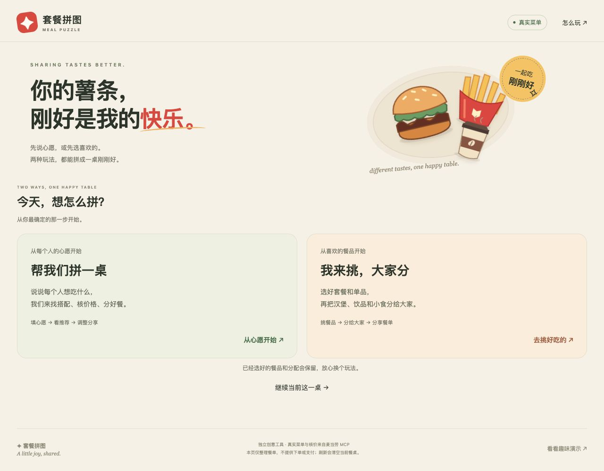

<p align="center">
  
</p>

<p align="center">
  <a href="LICENSE"></a>
  <a href="package.json"></a>
  <a href="MCP_INTEGRATION.md"></a>
  <a href="#立即在本地使用"></a>
</p>

<p align="center"><strong>真实菜单 · 官方核价 · 按人分餐</strong></p>

一起吃麦当劳，有人想喝咖啡，有人想吃汉堡，还有人只想分一份薯条。套餐拼图支持先说每个人的心愿，让系统推荐；也支持先挑套餐和单品，再分给大家。两种玩法都使用门店真实菜单，调用麦当劳 MCP 核清价格，最后得到一张清楚的餐单。

适合 **1–6 位朋友、同事或家人**一起商量到店自取餐单：一人操作，大家一起选。

[两种玩法](#两种玩法一张餐桌) · [真实案例](#两条真实流程) · [本地运行](#立即在本地使用) · [MCP 接入](MCP_INTEGRATION.md) · [参赛记录](SUBMISSION.md)



## 两种玩法，一张餐桌

| 首页入口 | 适合什么情况 | 怎么走 |
| --- | --- | --- |
| **帮我们拼一桌** | 大家知道想吃什么，还没决定买哪些套餐 | 选门店 → 按人填心愿与可选预算 → 比较最多 3 个已核价方案 → 自动分到餐盘 |
| **我来挑，大家分** | 已经有喜欢的套餐或单品 | 选门店 → 直接挑餐品、换搭配 → 点“选好了，分给大家” → 分到餐盘 |

进入餐桌后，都可以点餐品改归属、换套餐搭配，再复制或下载带门店、选配、核价时间和优惠条件的清单。“待分配”表示还没安排，“大家一起吃”表示有意共享。

切换玩法保留已选餐品、分配和仍有效的报价；换搭配后重新核价，未变餐品保留归属。用推荐方案替换已有餐桌前，会先提示确认。

## 两条真实流程

以下为 **2026-10-14 上海黄浦华旭国际大厦餐厅**的验收快照：通过本地页面连接真实 MCP，当前菜单包含 115 款餐品。

| 流程 | 这次怎么选 | 换搭配与核价结果 |
| --- | --- | --- |
| **先说心愿** | 阿橙要鸡肉堡、薯条、咖啡；小蓝要牛肉堡、可乐；小满要麦乐鸡、薯条 | 三桌方案分别为 **¥79.40 / ¥91.00 / ¥96.50**，均满足 **7/7 份心愿**。选第一桌后，将汉堡包换成吉士汉堡包，重新核价 **¥80.40** |
| **先挑餐品** | 选开心亲子双人餐，把汉堡和可乐分别分给两人，其余 6 份留作“大家一起吃” | 原核价 **¥59.50**；将可乐换成冰美式后重新核价 **¥68.50**，未变餐品的归属保留 |

两条流程都完成了选餐、分配、换搭配、重新核价和分享清单检查，也验证了中途切换玩法保留餐桌。餐品和价格随门店、时段及权益变化；完整过程和早餐案例见[验收记录](docs/VERIFICATION.md)。

## 立即在本地使用

准备 **Node.js 22+**。项目无第三方运行依赖，无需 `npm install`。

```sh
git clone https://github.com/jumpersun/meal-puzzle.git
cd meal-puzzle
cp .env.example .env
```

按[官方 MCP 接入指引](https://github.com/M-China/mcd-mcp-server)申请 Token，在本机 `.env` 的 `MCD_MCP_TOKEN=` 后填入并保存，然后启动：

```sh
npm start
```

打开 **[http://127.0.0.1:4317](http://127.0.0.1:4317)**，从首页选择一种玩法：

- **先试推荐**：点“帮我们拼一桌” → 选餐厅 → “填入示例心愿” → “看看怎么拼”。示例会根据当前早餐或非早餐菜单切换。
- **直接选餐**：点“我来挑，大家分” → 选餐厅 → 挑套餐或单品 → “选好了，分给大家”。

Token 仅由服务端读取，`.env` 已被 Git 忽略。默认位置为可修改的“上海人民广场”；端口占用时可用 `PORT=4318 npm start`。

**无 Token 体验：** 保留 `.env` 中的空值，启动后打开[趣味演示](http://127.0.0.1:4317/demo.html)，体验拼餐、分餐和清单交互。演示使用虚构菜单与示例价格，真实菜单和官方核价需配置 Token。

## 怎么把这桌拼出来

前端收集心愿或用户自选的餐品，服务端通过四个麦当劳 MCP 工具获取真实数据：

| 环节 | MCP Tool | 用途 |
| --- | --- | --- |
| 找餐厅 | `query-nearby-stores` | 查询附近门店 |
| 看菜单 | `query-meals` | 获取当前餐品、商品图、展示价与优惠标记 |
| 选搭配 | `query-meal-detail` | 读取套餐选项、默认搭配与数量规则 |
| 核价格 | `calculate-price` | 获取整桌实际报价 |

心愿模式下，规划器最多读取 20 款相关产品的详情，综合套餐各组的可换选项与可增选份数，组合候选并核价；最多尝试 6 个候选，成功核价 3 个后停止，再按**心愿满足度、实际总价、额外份数**排序。组合与分配由 JavaScript 完成，无需额外大模型或提示词。自选模式直接读取菜单和搭配，选好后使用同一套核价与分餐逻辑。

菜单中的购卡条件价、促销标记与本次核价分别展示，方便判断优惠是否适用于这一桌。商品图片按官方编码对应，缺图时显示“暂无图片”。调用流程、参数校验与部署要求见 [MCP_INTEGRATION.md](MCP_INTEGRATION.md)。

## 使用说明

- **心愿范围**：支持鸡肉堡/卷、牛肉堡、薯条、麦乐鸡、可乐、咖啡、早餐堡/卷、薯饼、粥，共 9 类；每人每类最多 3 份，整桌最多 18 份。具体品名、冷热与杯型可在方案详情确认。
- **预算与选方案**：预算用于显示余量或超出金额，缺少和多出的餐品会明确列出。推荐来自有限候选范围，不保证全菜单最低价。
- **价格有效期**：改餐、换门店或刷新菜单后需重新核价。报价快照展示 2 分钟，到期隐藏金额并提示刷新；该时长为应用展示规则。
- **使用方式**：由一人在本机操作和记录餐盘确认，刷新页面会清空当前餐桌。支持到店自取餐单整理，采用门店默认特调；下单与支付需在官方渠道完成。

## 开发与验证

原生 JavaScript 前端 + Node.js 服务端，另提供 Worker 适配层。

| 代码 | 职责 |
| --- | --- |
| [`public/journey.js`](public/journey.js) | 两个入口、步骤切换与下一步操作 |
| [`public/wish-planner.js`](public/wish-planner.js) | 心愿匹配、候选生成、按人分餐 |
| [`public/wishes.js`](public/wishes.js) / [`public/live.js`](public/live.js) | 心愿与方案界面、菜单、换搭配、餐单分享 |
| [`public/live-state.js`](public/live-state.js) | 共用餐单、报价有效性与分享清单 |
| [`server/api.mjs`](server/api.mjs) | MCP 会话、参数校验、候选核价与整单核价 |
| [`server.mjs`](server.mjs) / [`worker/index.js`](worker/index.js) | 本地服务与 Worker 运行入口 |

```sh
# 两种玩法、真实核价与选配恢复的相关测试
node --test tests/journey.test.mjs tests/live.test.mjs tests/planner.test.mjs tests/selection-recovery.test.mjs
# JavaScript 语法检查
npm run check
```

本次上述 **42 项测试通过**，并完成内置浏览器连接真实 MCP 的两条流程验收及 390×844 手机布局检查。更多请求生命周期、图片与 CSP 回归位于 [tests/](tests/)；验证范围与部署记录见 [docs/VERIFICATION.md](docs/VERIFICATION.md)。

## 文档与参赛

- [MCP 接入说明](MCP_INTEGRATION.md)与[脱敏配置示例](mcp-config.example.json)
- [参赛提交材料与演示脚本](SUBMISSION.md)
- [官方参赛声明](CONTEST_DECLARATION.md)
- [参赛 Issue #592](https://github.com/M-China/mcd-developer-innovation-challenge/issues/592)与[官方成功确认](https://github.com/M-China/mcd-developer-innovation-challenge/issues/592#issuecomment-6137220793)

本项目为独立参赛作品，非麦当劳官方产品。原创代码采用 [MIT License](LICENSE)；商品图片、商标及官方声明的权利范围见[素材说明](ASSETS.md)。
